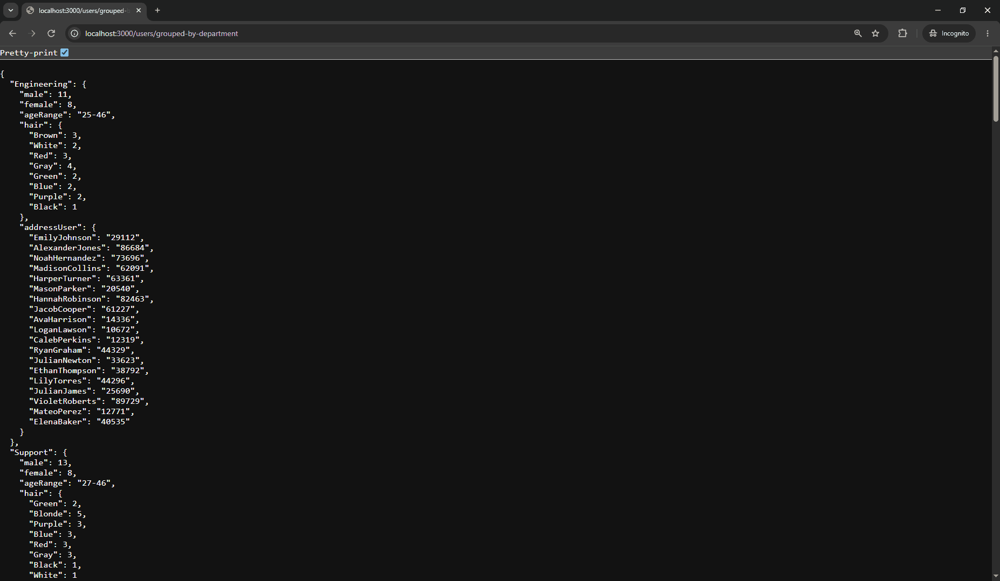
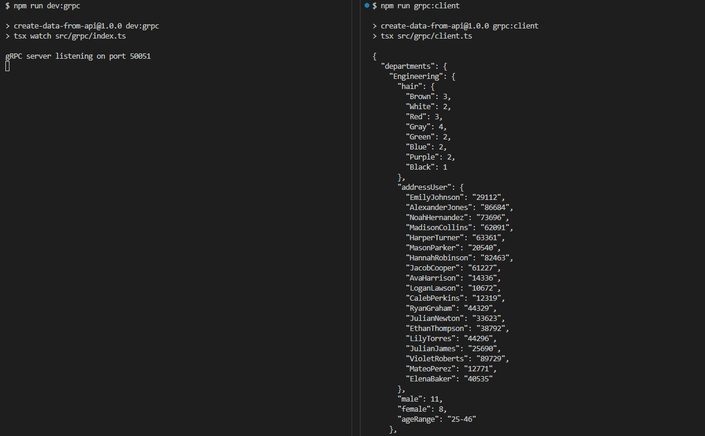

# create-data-from-api

A Fastify API that fetches users from [dummyjson](https://dummyjson.com/users) and transforms them into a summary grouped by department.

## Assignment

Source: [7-solutions/frontend-assignment — 2. Create data from API (optional)](https://github.com/7-solutions/frontend-assignment#2-create-data-from-api-optional)

> API from https://dummyjson.com/users
>
> - Your project must use Typescript, Typescript module, and HTTP framework (GRPC is plus)
> - Tranforms JSON data from API to new data groupBy department
> - We encourage you to write tests, which we will give you some extra score
> - We will give you an extra score if you focus on performance.

| Requirement                | Implementation                                                                    |
| -------------------------- | --------------------------------------------------------------------------------- |
| TypeScript + ES modules    | `"type": "module"`, `module: NodeNext`, strict mode                               |
| HTTP framework             | [Fastify](https://fastify.dev)                                                    |
| gRPC (plus)                | Optional gRPC server — see [gRPC](#grpc-optional)                                 |
| Transform grouped by dept. | [`transformUserListGroupByDepartment`](src/utils/transform.ts)                    |
| Tests                      | [Vitest](https://vitest.dev) — [`transform.test.ts`](src/utils/transform.test.ts) |
| Performance                | Single-pass transform — see [Performance](#performance)                           |

## Requirements

- Node.js 22.22.1+ (or 24+)

## Getting started

```bash
npm install
npm run dev
```

Then open http://localhost:3000/users/grouped-by-department

The server listens on port `3000` by default. To use another port:

```bash
# macOS / Linux / Git Bash
PORT=4000 npm run dev
```

```powershell
# Windows PowerShell
$env:PORT=4000; npm run dev
```

## Endpoint

### `GET /users/grouped-by-department`

Returns a summary of users per department.



Example response (truncated to one department and three users):

```json
{
  "Engineering": {
    "male": 11,
    "female": 8,
    "ageRange": "25-46",
    "hair": {
      "Brown": 3,
      "White": 2,
      "Red": 3,
      "Gray": 4,
      "Green": 2,
      "Blue": 2,
      "Purple": 2,
      "Black": 1
    },
    "addressUser": {
      "EmilyJohnson": "29112",
      "AlexanderJones": "86684",
      "NoahHernandez": "73696"
    }
  }
}
```

| Field         | Description                                    |
| ------------- | ---------------------------------------------- |
| `male`        | Number of male users                           |
| `female`      | Number of female users                         |
| `ageRange`    | `"<min>-<max>"` age of users in the department |
| `hair`        | Count of users per hair color                  |
| `addressUser` | `firstName + lastName` → postal code           |

## gRPC (optional)

The same data is also available over gRPC as a separate server, defined in [`proto/users.proto`](proto/users.proto).

```bash
# terminal 1 — start the gRPC server on port 50051
npm run dev:grpc

# terminal 2 — call GetUsersGroupedByDepartment and print the response
npm run grpc:client
```



The response has the same shape as the HTTP endpoint, wrapped in `departments`:

```json
{
  "departments": {
    "Engineering": { "male": 11, "female": 8, "ageRange": "25-46", "hair": {}, "addressUser": {} }
  }
}
```

To use another port:

```bash
# macOS / Linux / Git Bash
GRPC_PORT=50052 npm run dev:grpc
GRPC_ADDRESS=localhost:50052 npm run grpc:client
```

```powershell
# Windows PowerShell
$env:GRPC_PORT=50052; npm run dev:grpc
$env:GRPC_ADDRESS="localhost:50052"; npm run grpc:client
```

## Scripts

| Script                | Description                                 |
| --------------------- | ------------------------------------------- |
| `npm run dev`         | Start the dev server with watch mode        |
| `npm run build`       | Compile TypeScript to `dist/`               |
| `npm start`           | Run the compiled server from `dist/`        |
| `npm run dev:grpc`    | Start the gRPC server with watch mode       |
| `npm run start:grpc`  | Run the compiled gRPC server from `dist/`   |
| `npm run grpc:client` | Call the gRPC server and print the response |
| `npm test`            | Run tests in watch mode                     |
| `npm run typecheck`   | Type-check without emitting files           |
| `npm run lint`        | Lint with ESLint                            |
| `npm run format`      | Format with Prettier                        |

## Project structure

```
proto/
└── users.proto                      # gRPC service contract
src/
├── index.ts                         # HTTP entrypoint
├── http/
│   └── server.ts                    # Fastify server and route (fetch, validate, transform)
├── grpc/
│   ├── index.ts                     # gRPC entrypoint
│   ├── server.ts                    # gRPC service handler (fetch, validate, transform)
│   ├── proto.ts                     # Load users.proto
│   └── client.ts                    # Example gRPC client
├── services/
│   └── users.ts                     # Fetch users from dummyjson
├── types/
│   ├── services/user.ts             # API response types
│   └── transform/user.ts            # Transform result types
└── utils/
    ├── resTypeCheck.ts              # Runtime type guard for the API response
    ├── transform.ts                 # Group users by department
    └── transform.test.ts            # Transform tests
```

## Tech Stack

- **TypeScript** — ES modules, strict mode with `noUncheckedIndexedAccess`
- **Fastify** — fast HTTP framework with built-in logging and TypeScript support
- **gRPC** — [`@grpc/grpc-js`](https://github.com/grpc/grpc-node) with [`@grpc/proto-loader`](https://www.npmjs.com/package/@grpc/proto-loader) loading `users.proto` at runtime
- **Vitest** — fast test runner with native ESM and TypeScript support
- **ESLint + Prettier + Husky + lint-staged** — lint and format on commit, type-check and test on push

## Performance

- **Single pass, O(n)** — users are grouped, counted and their age range computed in one `reduce`, with no second loop over departments.
- **No per-iteration copying** — the accumulator is local to the function, so it is mutated in place instead of spreading objects on every user (which would be O(n²)).
- **One API request** — `?limit=0` fetches all users at once instead of paginating.
- **Fastify** — one of the fastest Node.js HTTP frameworks.
